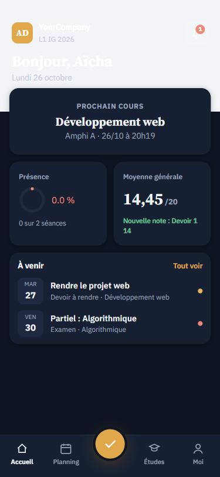
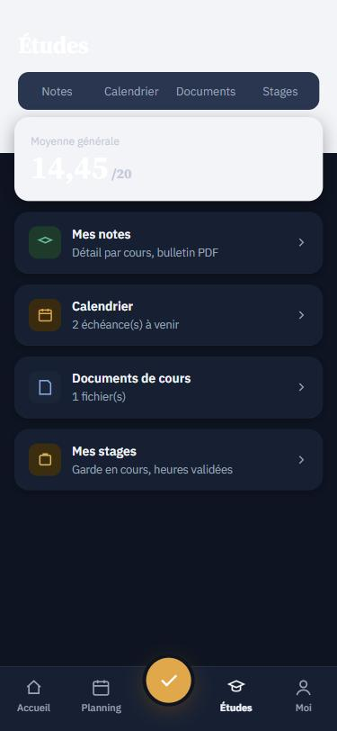
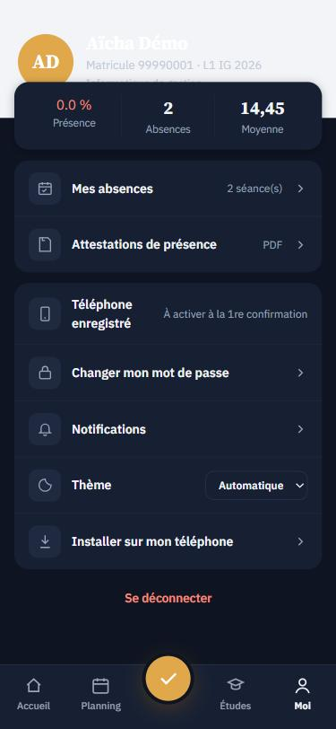
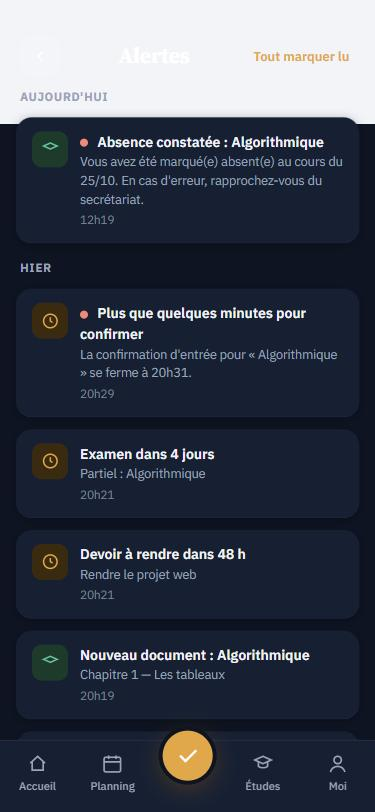

# Présence Campus

**La présence étudiante par GPS, Wi-Fi et empreinte digitale, pour les écoles et universités. Sur Odoo 18, avec une application installable qui fonctionne même sans réseau.**

[](LICENSE)


> Conçu au Bénin pour des campus où le Wi-Fi coupe, où certains étudiants n'ont pas de téléphone récent, et où l'on ne veut pas payer des lecteurs biométriques dans chaque salle.

<p align="center">
  
  
  
  
</p>

*(Captures en mode sombre, avec des données de démonstration.)*

---

## Pourquoi ce projet

L'appel papier prend du temps, se falsifie (un étudiant signe pour un absent) et ne donne aucune statistique. Les systèmes biométriques coûtent cher et font la queue. **Présence Campus remplace l'appel par une confirmation que l'étudiant fait lui-même, sur son téléphone**, avec trois preuves vérifiées automatiquement :

| Preuve | Comment |
|---|---|
| **Où il est** | Sa position GPS doit être dans le rayon de la salle (30 m par défaut). |
| **Sur quel réseau** | Il doit être connecté au Wi-Fi de l'école (réglable). |
| **Qui il est** | Il déverrouille son téléphone (empreinte, Face ID ou code) : norme **WebAuthn**. Aucune donnée biométrique ne quitte le téléphone. |

## Ce que le système sait faire

**Présence**
- Confirmation d'entrée **et** de sortie, avec fenêtres horaires et compte à rebours.
- Séances générées chaque jour depuis l'emploi du temps ; QR codes stylés (logo, couleurs) et affiches PDF pour les salles.
- Un appareil par compte ; détection des fraudes (GPS identique, confirmations groupées, déplacement impossible, appareil partagé).
- **Étudiants sans téléphone** : confirmation relayée par l'enseignant ou le délégué, avec quota, contrôles aléatoires et comptage des têtes.
- **Mode hors ligne** : si le Wi-Fi de l'école tombe, la confirmation est signée sur le téléphone puis vérifiée au retour du réseau.

**Application étudiante (PWA)**
- S'installe sur le téléphone, sans passer par un store. Mode clair, sombre ou automatique.
- Accueil, planning, notes, calendrier, documents de cours, absences, attestations, alertes.
- Notifications push (norme Web Push, sans Firebase).

**Gestion**
- Filières, promotions, cours, salles, emploi du temps, scolarité (paiements).
- Boîte « À traiter » pour le secrétariat ; statistiques par étudiant, cours, filière, promotion, enseignant.
- **Journal d'audit infalsifiable** (chaîné par empreintes SHA-256) et 5 échecs de connexion = compte signalé.
- Notes, moyennes selon les règles de l'école, bulletins PDF, calendrier avec rappels.
- **Stages cliniques** : gardes validées par un superviseur, suivi GPS continu et contrôles d'empreinte aux heures de pause, compteur d'heures, relevé PDF.

Le détail de chaque fonction est dans le **[guide complet](docs/guide-projet.html)** (à ouvrir dans un navigateur après téléchargement).

## Les modules

| Module | Rôle | Version |
|---|---|---|
| [`school_base`](school_base) | Étudiants, enseignants, filières, promotions, cours, salles, emploi du temps, paiements | 18.0.5.0.0 |
| [`school_attendance_qr`](school_attendance_qr) | Présence, application étudiante, hors ligne, relais, notifications, sécurité, surveillance | 18.0.11.0.0 |
| [`school_academic`](school_academic) | Évaluations, notes, bulletins, calendrier, documents de cours | 18.0.1.0.0 |
| [`school_internship`](school_internship) | Stages cliniques et gardes | 18.0.1.0.0 |

Seuls les deux premiers sont nécessaires pour la présence. Les deux autres sont facultatifs.

## Démarrage rapide

```bash
# 1. Odoo 18 Community déjà installé, avec Python 3.12 et PostgreSQL
git clone https://github.com/mahelmouzoun07-afk/presence-campus.git ~/presence-campus

# 2. Dépendances Python (dans l'environnement d'Odoo)
pip install webauthn qrcode pillow reportlab pywebpush

# 3. Installer les modules sur une base de données
./odoo-bin --addons-path=addons,$HOME/presence-campus -d mon_ecole \
  -i school_base,school_attendance_qr,school_academic,school_internship --stop-after-init

# 4. Lancer
./odoo-bin --addons-path=addons,$HOME/presence-campus -d mon_ecole --proxy-mode
```

Les téléphones exigent une adresse **HTTPS** pour l'empreinte et l'installation de l'application : voir le [guide d'installation](docs/INSTALLATION.md) (tunnel Cloudflare gratuit pour tester, hébergement dans l'école ou en ligne pour la production).

## Documentation

| Document | Contenu |
|---|---|
| [Installation](docs/INSTALLATION.md) | Prérequis, installation pas à pas, premiers réglages, tests |
| [Utilisation](docs/UTILISATION.md) | Guide par rôle : secrétariat, enseignant, étudiant, superviseur, direction |
| [Versions](docs/VERSIONS.md) | Historique v9 à v12, **comment installer et utiliser chaque version** |
| [Infrastructure](outils/INFRA.md) | Sauvegardes chiffrées, surveillance, tunnel nommé, mode sans Internet |
| [Guide complet](docs/guide-projet.html) | Fonctionnement détaillé du système |
| [Contribuer](CONTRIBUTING.md) · [Sécurité](SECURITY.md) | |

## Versions

Chaque version est un **tag Git**. `git checkout v11` redonne exactement cette version.

| Tag | Contenu |
|---|---|
| `v9`, `v9b` | Présence par QR permanent, entrée et sortie |
| `v10` | Tableau de bord enseignant, alertes, attestations, scolarité |
| `v11` | Portail étudiant et empreinte (WebAuthn) |
| `v12` | Application installable, hors ligne, notes, stages, sécurité renforcée, nouvelle interface |

## Tests

68 tests automatiques couvrent la présence, la sécurité, le hors ligne (avec un faux téléphone qui signe réellement), les notes, les stages et les pages du portail.

```bash
./odoo-bin --addons-path=addons,$HOME/presence-campus -d presence_test \
  -i school_base,school_attendance_qr,school_academic,school_internship \
  --test-enable --stop-after-init
```

## État du projet et limites

Projet en développement actif, **pas encore audité** et pas encore déployé en production. À connaître :

- Un GPS peut être falsifié par une application de fausse position : le système rend la fraude visible et coûteuse, il ne la rend pas impossible.
- Une application web ne suit pas le GPS écran verrouillé. Les stages s'appuient donc sur des contrôles d'empreinte aux pauses.
- **Données personnelles** : la localisation des étudiants est une donnée sensible. Avant tout usage réel, informez les étudiants et faites valider le traitement (au Bénin, loi sur les données personnelles et APDP).

## Licence

[GNU LGPL v3](LICENSE), comme Odoo et comme les modules déclarés dans leurs `__manifest__.py`.

## Auteur

Créé par [Mahel](https://github.com/mahelmouzoun07-afk), avec l'aide de Claude (Anthropic) pour la conception et le code.
